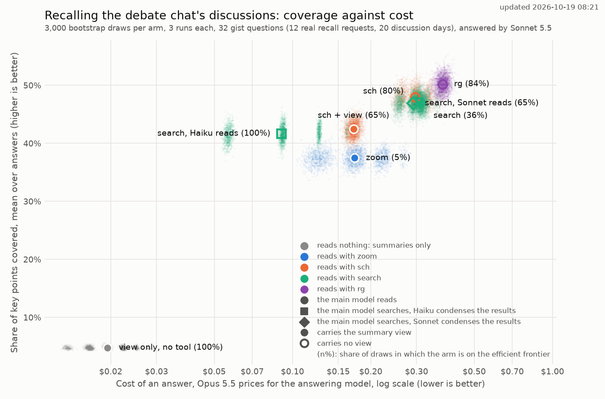
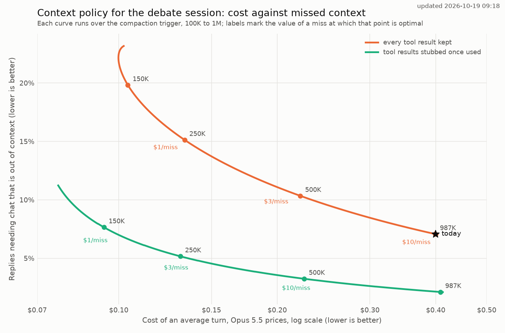
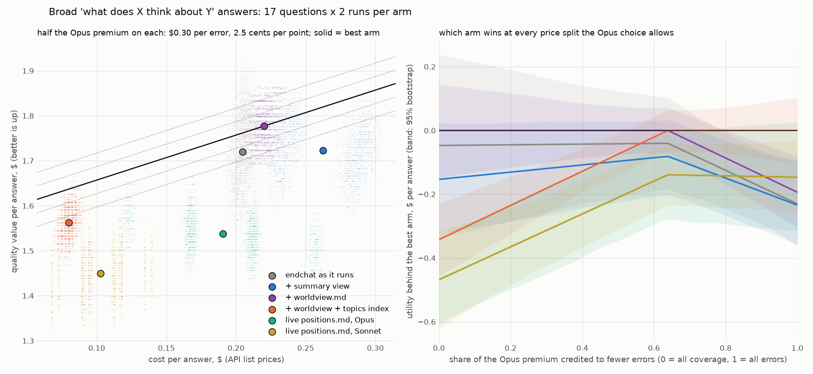

# What a real never-ending chat needs from its history

The [search-tools evaluation](../search-tools/README.md) chose how endchat should reach its past on a synthetic benchmark that only asks recall questions, and it could not say what a smaller view, or none, costs the ordinary turns that make up most of a chat. This evaluation answers that on a real chat: a two-person Signal debate group with a bot that ran in a long-lived [Claude Code](https://docs.claude.com/en/docs/claude-code/overview) session and moved to endchat's raw-history mode on 2026-10-19 because of what is reported here.

The short answer: on the real chat the summary view does nothing that search does not do better, so endchat now sends the chat word for word with no view at all. What makes a long-running session expensive is not its history but its own tool output, about nine tenths of the context, which almost no later turn reads again. Replacing each tool result with a one-line stub once its turn is over, and cutting the history at about 160K tokens, keeps the session's quality at about a quarter of the cost: replayed through endchat, real turns scored level with the same model rerun on the live session, at about 10 cents a turn instead of 40. What search cannot do is notice, unasked, that something said months ago matters; a compact index of each person's positions, loaded every turn, raised that from 1 in 40 replies to 12 in 40 without adding errors in the test. In live use it also produced quotes that matched a topic but not the argument, so the chat now brings up past positions only when someone asks.

Five measurements carry the result: recall questions written from the chat itself, a labelling of how far back real replies reach and what they reach for, a cost model of the session built from its own logs, a replay of real turns through endchat judged against the live session, and a test of what a loaded orientation layer adds to replies that never ask for recall.

## Recall on the real chat

The benchmark's questions repeat the words of their evidence and ask for single facts, which favours search over summaries. To give the view its best case, the chat was asked two kinds of question: twelve real requests from the chat in which someone asked the bot to recall something, and twenty "how did this day's discussion go" questions, each about one busy day, the kind of gist a summary exists to keep. Each comes with three to five key points, and a judge scores the share of them an answer covers.

The view alone covers about 5% of the key points. Adding it to [search-clanker-history (sch)](https://github.com/wakamex/search-clanker-history) made sch slightly worse, 43% against 48%, and cost more per answer. Opening summaries with zoom covers 37%, the lowest of the designs that read the original messages. sch, [ripgrep](https://github.com/BurntSushi/ripgrep) and [ColBERT-Zero](https://huggingface.co/lightonai/ColBERT-Zero) search all land between 47% and 50%, within the noise of each other. On 88 harder single-fact questions from the same chat the order is the same: sch with no view answers about 83, with the view about 81, zoom about 68 and the view alone about 8.

The same questions answered with the relevant day's text in context score 58% with Sonnet and 70% with Opus, so recall through search loses about 10 points against having the text in hand. That gap is what a turn pays when what it needs has fallen out of context.

## How far back real replies reach

400 of the bot's past replies were labelled with what they used from earlier in the chat, where in the chat that came from, and whether the view states it:

- About a quarter of replies use chat from more than 20,000 characters back, and how far back they reach falls off as a power law.
- About a third use something that was never in the chat: tool output, files and memory.
- The view states what the reply needed in 20 of the 228 cases checked.

## Where the cost of a turn goes

Over a full compaction cycle of the live session, tool results were 90% of its transcript, tool calls 4% and the conversation itself 6%. The context grew about ten tokens for every token of chat, so the session's one-million-token window held only a few days of conversation, and a turn cost about 40 cents at Opus prices, almost all of it rereading old tool output.

Old tool output is rarely used again. Tracing every distinctive token the bot wrote back to where it first appeared, 5.7% of turns use a tool result from an earlier turn, 3.6% one older than ten turns, and 1.3% one older than a hundred. A rerun brings an old result back for a few cents once, while carrying it costs that on every turn.

The cost model combines these: calls per turn, cache-miss rate, context growth with and without stubs, compaction cost, and the share of replies whose needed chat has fallen out of the window at each trigger. Each curve runs the compaction trigger from 100K to 1M tokens.

Stubbing tool results once used beats keeping them at every trigger, on both cost and misses. With stubs, a trigger of about 160K tokens matches the live session's 7% of replies missing chat at about 10 cents a turn. Where on the green curve to sit depends on what a miss is worth; the model's optimum stubs everything older than the previous turn whatever that value is.

## Replaying real turns through endchat

34 consecutive real turns were replayed through endchat in raw mode, as native Claude Code turns with the chat's own instructions and memory, each seeing endchat's own earlier replies as it would live. A blind Sonnet judge compared each reply with a baseline.

Against the replies actually sent, the live session still won, 18 turns to 12 with 4 ties. But one sent reply is a single draw: the live session resumed just before each turn and rerun did not reproduce its own replies either. Against those reruns, on 15 of the turns, endchat was better on 7, the live session on 5, with 3 ties, and the judge accepted 11 of endchat's replies against 10. Endchat's replies averaged 629 characters against 591 for those sent, read 94% of each prompt from the cache, and cost 9.5 cents a turn.

The turn note decides most of that behaviour. A softer wording of the same participation and length rules ("a few sentences is usually enough" in place of "default to 1-3 sentences") won more head-to-heads against the sent replies, 16 to 15, but the judge accepted fewer of its replies, 18 of 34 against 20; it stayed silent on 3 of the 11 turns where the live session had, against 4; and its replies grew to 742 characters on average, from 649 in the first half of the thread to 829 in the second. Since the judge prefers longer answers, the head-to-head gain is mostly length. The debate profile runs the softer wording, with a fixed line against bold, italics and em dashes added to the note; endchat reads the note only when `serve` starts, so a note edit takes effect after a restart.

## Noticing old context without being asked

Every recall question above tells the model it has to recall something. In a real chat the harder failure is not knowing there is anything to look up. This test wrote 20 messages either participant might plausibly send, none asking for recall, each of whose best reply depends on something said at least two months earlier: a concession, a contradiction, or a prediction that can now be checked. It added 17 broad questions of the form "what does one participant think about a topic", and "what do you know about me" from each participant. Questions and key points were drafted from the raw archive by runs that never saw the layers under test, balanced between the two participants, and spot-checked against the cited lines for sarcasm. Each layer was loaded every turn on top of raw-mode endchat, two runs each:

- Raw endchat alone brought up the old point in 1 of 40 replies.
- With the summary view, 6; with a hand-written page of each person's worldview, 4; with that page plus a 28,000-character index of 247 positions across 17 topics, each with dates and archive line numbers, 12.
- "What do you know about me" coverage rose from 4% to 31% with the index, on only four replies per layer.

On the broad questions the first judge reported the index arm making the most errors, 37 against 10 to 21. That judge could only see the lines each question cited, and flagged true claims backed by other lines as invented. A judge that searches the whole archive before flagging rescored the same answers: 16 errors for raw endchat, 13 with the view, 13 with the worldview page and 10 with the index, the fewest. The index arm searched less, 0.8 tool calls an answer against 1.8, which made it the cheapest at about 10 cents, and covered fewer key points, 67% against 75 to 77%.

The index now opens with one sentence telling the model to search the archive before attributing anything from it. With that sentence, errors were 12 of 34 at 19 cents an answer; without it, 18 at 25 cents. The live index keeps the sentence, and now carries each person's worldview summary above the topic index, about 39,000 characters in one file.

The test counted how often a reply raised old context, not whether the old line fit the claim being argued. In three days of live use one participant counted 10 to 20 replies that quoted them into a position they did not hold, and at least one checked case was a real miss: a 2024 line about competing with Chinese wages was quoted as support for a higher minimum wage. The search-first sentence makes the model look a line up, but not check that it addresses the same claim. The chat's standing rules now allow a past quote only when someone asks for history or context, and only when it addresses the claim being argued, supporting or contradicting it. A rerun of the orientation test would need a judge that scores fit as well as frequency.

## Pricing quality by revealed preference

Cost is in dollars and quality in rubric points or error counts, so choosing a point on a frontier needs an exchange rate. A choice already paid for supplies a floor on one: the chat runs on Opus rather than Sonnet, so whatever Opus buys is worth at least its premium. Scoring both models on the same questions and dividing the cost gap by the quality gap prices any measure a judge can count reliably, whether coverage, errors, missed callbacks or silence on asides.

With the relevant chat in context, Opus covered 70% of gist key points and Sonnet 58%, at about 12 cents a turn more, about 1 cent a point. Under that rate the cost model's optimum trigger sits at its 100K floor, and the 160K setting buys back the live session's miss rate for about 2 cents a turn.

When one premium buys several measures at once, it cannot be split between them from the data. On the broad questions Opus made 0.15 fewer errors and covered 1.8 more points per answer for 8.8 cents more, so any split from $0.59 per error with coverage worth nothing to 4.9 cents per point with errors worth nothing fits. Pricing every arm at every split gives a crossover instead of a single answer: if 64% or more of the premium pays for fewer errors, the index wins; below that, the worldview page alone wins. The chat's owner counts a wrong answer as worse than a missed one, which puts the choice above the crossover.

## Takeaways

### The view's job is done by search and by the cut summary

On the real chat, as on the benchmark, the view adds nothing to search, and it fails even at the gist questions written to favour it. What a summary is still good for is orientation after the history is cut: what was being done and what was decided. Raw mode writes one summary of each cut, not one per message. The cut call reads the chat as material, and a model can refuse it as pasted content; endchat keeps a cut's reply only when it contains a `
` block and otherwise retries.

### The expensive part of a long session is its own tool output

History is a small share of what a session carries. A design that only manages the conversation leaves nine tenths of the cost untouched, and stubbing old tool output is the largest single saving available.

### Stubbing needs cache marks the harness does not expose

Editing an old message invalidates the prompt cache from that message on. Claude Code places its own cache marks and offers no setting, hook or variable to move them, so stubbing its transcript means rewriting the whole cached context each time. endchat places its own marks, so stubbing the turn that just ended costs only that turn.

### Replies drift toward the length of the replies before them

Without the fixes below, replayed turns spoke on too many turns and ran about twice as long as the live session, and the gap grew over the thread. Most of it came from rules that only lived in memory files the model never loaded at startup, and from a turn note that told it to match its earlier replies, which were its own. Moving the chat's standing rules into the project instructions and giving the note a fixed length rule closed most of it. The system prompts of interactive and headless Claude Code, captured locally, differ only in their first line, so the harness mode was not the cause.

### Most of a fresh session's prompt is tools and skills it never uses

The captured interactive request was 143,000 characters before any chat: 67,000 of tool definitions, one of them 38,000 alone, and 25,000 of skill descriptions for 50 skills, against 36,000 of instructions and memory. Denying unused tools and turning off unused skills in settings halved it to 72,000, and the headless request endchat sends went from 92,000 to 66,000. Denied tools leave the request entirely rather than only refusing calls.

### Search answers what it is asked; an index tells it what to ask

Removing the view and per-message summaries is right for recall, but it leaves the model blind to anything older than the window that nobody mentions. A compact index of positions does what the view was meant to do as orientation at a fraction of its size, and it does it better because it is organised by subject rather than by date. It needs a rule against quoting it unchecked, and its entries need checking for sarcasm before they go in. Loaded every turn, it also pulls old quotes into arguments they do not fit, so it works best as background with quoting left to explicit requests.

## Why these quantities

### Questions from the chat itself

The real requests are what the chat actually asks of its history. The day questions are what a summary should do best, so if the view loses there it loses everywhere. Key-point scoring credits partial answers, which a right-or-wrong judge on gist questions cannot.

### An in-context ceiling

Recall coverage means little without what the same model scores with the text in front of it. The gap between the two is the price of a miss.

### Reach-back from real replies

The rate at which ordinary turns need older chat decides how small a window can be, and no benchmark measures it. Labelling real replies, and locating each one's source in the archive, gives that rate as a function of distance, which turns into a miss rate for any trigger.

### Reuse traced mechanically

The policy depends on how often an old tool result is used again. Tracing tokens through the transcript measures it without a model, at the price of some false matches on common names and some uses that leave no token behind.

### Judged against the live session rerun

A reply that was actually sent is one sample from the live session, and comparing a new design with it scores luck as a gap. Rerunning the live session on the same turns gives a baseline drawn the same way as the replay.

## Limits

- Everything comes from one chat, and the replay from one thread of 34 turns. The replay shows parity, not a precise edge.
- The orientation test measured how often old context came up, not whether it fit; live use found misfits it could not see.
- The orientation test ran two runs per arm on 40 unprompted messages and 34 broad answers, so 12 against 1 is a clear effect but differences of a few points or errors are not.
- An error judge that only sees the evidence a question cites flags true claims as invented. Error counts here come from a judge that searches the whole archive.
- The judge prefers longer answers in side-by-side comparisons, which favours whichever side writes more.
- Four of the 768 recall answers ran away to the output cap and cost dollars each; they appear as clumps in the cost clouds and inflate the cost of the designs they fell in.
- Costs are at Opus 5.5 list prices; on a subscription they are usage-limit headroom rather than dollars.

## Reproducing

The chat is private, so the harness is not published. It consists of a recall runner over endchat arms, gist-question generation from chat days, key-point judging, the in-context ceiling, the reach-back labeller, the token-reuse tracer, the context-policy model, the turn replay, and the orientation test with its question drafting, position extraction and searching judge. The endchat side is all configuration described in the [endchat README](../../README.md): `turn.raw`, `turn.native`, `stub_chars`, `limits.raw_high` and `limits.raw_low`, `tail_note`, and `contrib/claude_session.py` to import a Claude Code session.
