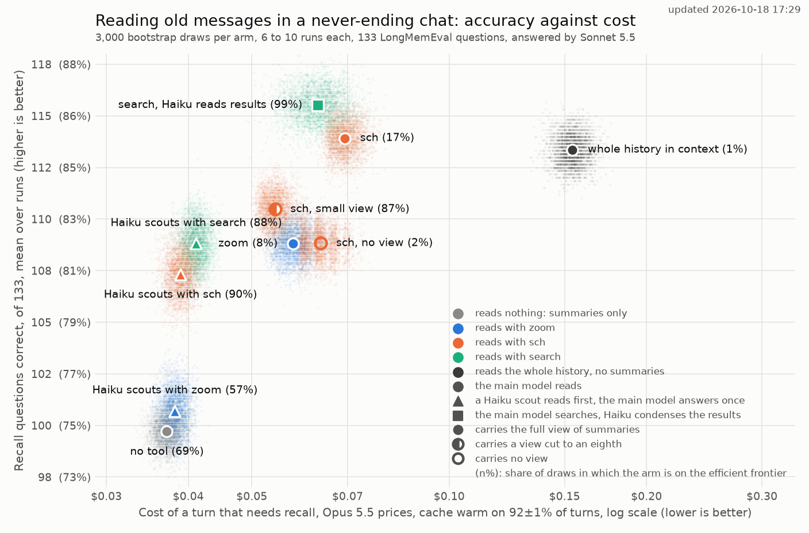
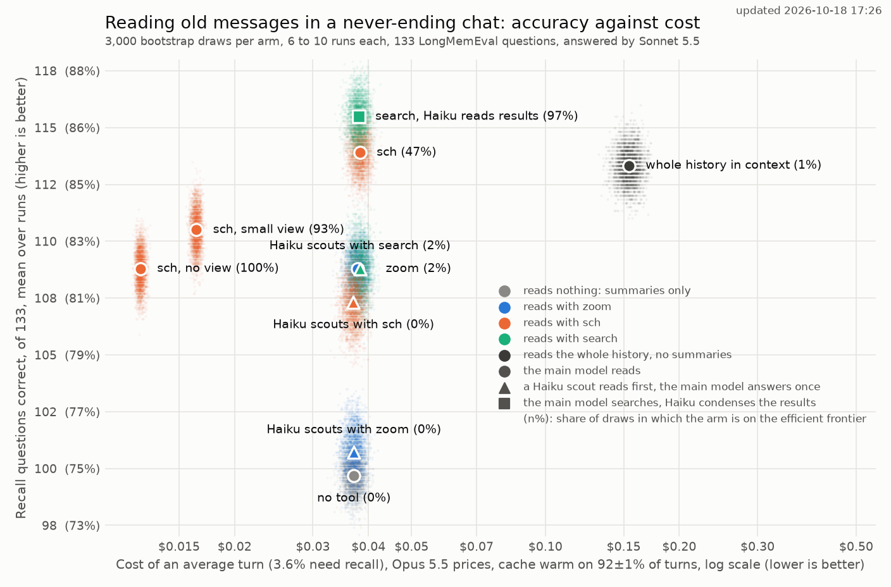

# How a never-ending chat should read its own history

endchat keeps a chat that never ends by sending the model a view of one-line summaries of the whole history, and lets it open any summary into the original messages with `zoom`. This evaluation asks whether that is the right way to give the model its past: how reliably each design finds what a question needs, and what each costs per turn.

The short answer: letting the model search the original messages beats drilling down through summaries, a plain regular-expression search does as well as an embedding model, and the cost that separates designs is what every turn pays to carry the view, while the lookups themselves are nearly free. Sending the whole history in the prompt is no more accurate than summaries plus search, and costs several times as much per turn.

Each design answered the multi-session questions of [LongMemEval](https://github.com/xiaowu0162/LongMemEval), each asked against the same imported chat of a few hundred messages, ten times over, with Claude Sonnet 5.5 answering through the [Agent Orchestration Process (AOP)](https://github.com/wakamex/agent-orchestration-process).

The first chart compares the designs on the turns the benchmark asks about, those that need the chat's history. Each cloud shows where a design's accuracy and cost could plausibly lie, and the figure beside its name is how often it is on the efficient frontier, where no other design is both cheaper and at least as accurate.

Most real turns need no history at all: in my own coding-agent use about one turn in thirty looks anything up. The second chart keeps the same accuracy but prices an average turn at that rate, so a lookup's cost is paid only now and then, while carrying the view is paid on every turn. That moves the designs that send a smaller view, or none, far to the left.

Counting every turn changes which designs are worth choosing, while their accuracy stays where it was. On recall turns alone, the designs that save the main model work look cheapest: a Haiku scout answers in one main call, and a Haiku reader keeps search results short. Over every turn, those savings shrink to almost nothing, because they apply only on the rare turn that looks something up, while the scout's extra Haiku call is paid on every turn. All designs that carry the full view then cost about the same, and the choice among them comes down to accuracy, where the main model searching for itself leads. The designs that carry a smaller view, or none, become the cheapest by far, because carrying the view is the cost every turn pays. The whole history in context stays the most expensive on both charts, since every one of its turns rereads everything.

## The designs compared

All but the last two keep endchat's view of summaries and differ only in how the model reaches the original messages:

- no tool: the view alone
- zoom: endchat as it ships
- sch: [search-clanker-history (sch)](https://github.com/wakamex/search-clanker-history), a regular-expression search over the raw log that prints a short window around each match
- search: the messages ranked best for a query in plain words by [ColBERT-Zero](https://huggingface.co/lightonai/ColBERT-Zero), an embedding model run locally; with Haiku reads results, Claude Haiku 5.5 condenses them to the passages that bear on the question
- Haiku scouts: Haiku takes the turn first with one tool (zoom, sch or search) and reports quotes, and the main model answers in a single call without tools
- sch, small view: the view cut to about an eighth of its size
- sch, no view: no view at all, so the chat is reachable only through sch, as in a fresh coding-agent session
- whole history in context: the full chat in one call, without endchat

## Results

Questions correct out of 133, averaged over 10 runs (6 for the whole history) with a 95% interval, and cost per turn at Claude Opus 5.5 prices: for a turn that needs recall, and for an average turn, of which about one in thirty needs recall.

| Design | Correct, of 133 | 95% interval | Cost of a recall turn | Cost of an average turn |
|---|---|---|---|---|
| search, Haiku reads results | 115.5 | 114.0 to 117.0 | $0.063 | $0.038 |
| sch | 113.9 | 112.4 to 115.4 | $0.069 | $0.038 |
| whole history in context | 113.3 | 112.0 to 114.7 | $0.154 | $0.154 |
| sch, small view | 110.5 | 108.9 to 112.0 | $0.054 | $0.016 |
| zoom | 108.8 | 107.4 to 110.2 | $0.058 | $0.038 |
| sch, no view | 108.8 | 107.4 to 110.2 | $0.064 | $0.012 |
| Haiku scouts with search | 108.8 | 107.0 to 110.6 | $0.041 | $0.038 |
| Haiku scouts with sch | 107.3 | 105.5 to 109.1 | $0.039 | $0.037 |
| Haiku scouts with zoom | 100.7 | 98.9 to 102.5 | $0.038 | $0.037 |
| no tool | 99.7 | 98.5 to 100.9 | $0.037 | $0.037 |

## Takeaways

### Searching the raw messages beats drilling through summaries

A summary keeps a topic and drops what the summarizer thought minor, so zoom can only open what a line points to, and a fact mentioned in passing is often invisible from the view. Search tools reach the original messages directly and found about twice as much of the evidence. Zoom is the most precise when it does find everything, but that is the exception, and offered both tools the model almost never zooms after searching.

### A regular expression matches an embedding model here

sch and ColBERT search answer equally well. The model does not search with the question's words: it reads the chat's own vocabulary off the view and writes its patterns from that, so even questions reworded to share no word with their evidence leave sch only slightly behind. The embedding model needs a GPU and an index that grows with the history; sch needs neither.

### What the tool returns matters more than how it finds it

Search results are mostly long assistant replies around a fact the user mentioned in passing. Having a cheap model condense them to quotes keeps the answers and removes nearly all the text. Cutting messages to the sentences that best match the query works poorly, because the answer usually sits beside the match rather than in it.

### Delegating the lookup to a cheaper model loses accuracy

A Haiku scout saves the main model a second call but passes on only what it chose to quote, and lands a step below the designs where the main model searches for itself. With zoom as its tool it barely beats no tool. Once lookups are rare, its saving disappears while its extra call on every turn remains.

### The view is the cost; lookups are nearly free

Every turn pays to carry the view, and only a few percent of turns need to look anything up, so all designs with the full view cost about the same per average turn. The one lever left is the size of the view. A smaller view or none at all makes every turn much cheaper, at a modest cost in recall, and how much it costs ordinary turns is not measured here.

### The whole history in context is no better and costs several times as much

These chats fit easily in the context window, and sending all of it answers no better than summaries plus search. Even with the cache warm, rereading the whole history on every turn costs several times as much as the view, and the gap grows with the history until it no longer fits.

## Why these quantities

### Questions that need the history

The test is a question whose answer lies in earlier messages, often several of them, such as "how many weddings have I attended this year". That is the one job the view and its tools exist for. Questions that need only the current message would score every design the same. Answers are judged by the strict LongMemEval prompt with gemini-3.8-flash.

### Evidence found, alongside answers

LongMemEval marks the messages that hold each answer. Counting how many of them a tool returned separates two failures that a wrong answer conflates: the tool never showed the evidence, or the model had it and still answered wrongly.

### Cost per turn, with the prompt cache as it is really used

Cost is priced at Opus 5.5 rates, the model endchat would run in daily use, from the token counts of the Sonnet runs. Every call goes through the one-hour [prompt cache](https://docs.claude.com/en/docs/build-with-claude/prompt-caching), and whether a turn finds the view already cached decides most of its cost. So each turn is priced at the share of my own prompts that found the cache warm, about nine in ten, measured from session logs.

### An average turn, not only a recall turn

Every benchmark question needs the history, but most real turns do not: in my own coding-agent logs about one turn in thirty reached into a past session. The second chart prices an average turn at that rate, with the other turns making one call over the view and no tool call.

### Repeated runs

The same design on the same questions gives a somewhat different score each run, and the judge adds its own variation. One run cannot separate designs a few questions apart, so each design ran ten times, and the intervals measure how well its average on these questions is pinned down.

### Clouds and the frontier

Each chart draws every design as a cloud of bootstrap draws of its accuracy and cost. The figure beside each name is the share of draws in which the design is on the efficient frontier, where no other design is cheaper and at least as accurate. It says how often a design is worth choosing given the uncertainty, which a single frontier line cannot.

### Reworded questions

The benchmark's questions repeat the words of their evidence, which suits a regular expression. The same questions rewritten to share no content word with their evidence test whether sch still works when the question is asked in other words.

### A ranker chosen on other questions

ColBERT-Zero was chosen as the best of several rankers on these questions, and it stayed the best on other LongMemEval question types that played no part in choosing it.

## Limits

- The view also carries the recent conversation, which ordinary turns depend on ("make it shorter", "do the same for the other file"). The benchmark scores only recall, so what a smaller view or no view loses on ordinary turns is not measured, and the per-turn chart assumes it loses nothing.
- Each chat is a few hundred messages of synthetic conversation. Longer histories favor designs that do not send everything, and real chats differ in how often facts recur.
- The recall rate comes from one person's coding-agent use, where the current session stays in context, and may not match a chat that never ends.
- Answers come from Sonnet and costs from Opus prices; Opus would likely think longer and score somewhat higher.

## Reproducing

The endchat options these runs use are configuration keys described in the [endchat README](../../README.md): `[turn.commands]` for the text tools, `zoom` and `view` to switch zoom or the view off, `tail_note`, and `system_prompt`. The harness is in the longmem repository: `eval_endchat_tools.py` runs an arm, `replicate_arms.py` repeats it and `replicates.py` compares arms, `plot_tool_arms_cloud.py` draws the charts, `warm_share.py` and `recall_rate.py` measure the warm share and the recall rate from session logs, and `reword_questions.py` builds the reworded set. Prompts for every arm are under `prompts/` there.
